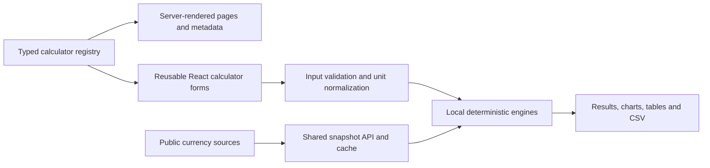

# Architecture and design

Finflo uses actual Next.js 16.4 App Router, React 19.3, strict TypeScript and Tailwind 4.3. Server-rendered explanations, links, worked examples and structured data remain readable before interaction. Client components handle forms and local results. Engines are loaded by category; Base64 codecs, the map picker and file utilities are loaded only when needed.

## Data flow

`registry.ts` clones base definitions before enrichment. The catalog drives routes, categories, search, links and sitemaps. Calculation modes declare their fields, units, defaults, formulas and limitations. Conditional controls reset inactive inputs to defined defaults before evaluation, preventing hidden stale values from changing results. Specialized row editors, expression controls, coordinate selection, unit selectors and file controls share the same result and validation structure.

Financial ledgers use stable analytic formulas or Decimal arithmetic where needed. Fractions, arbitrary integers and IP ranges use appropriate exact representations. Display rounding is separate from engine arithmetic. Versioned data records US 2025/2026 tax parameters, current scoped vehicle-tax rules, health reference tables and other changing policies. A year selector never changes jurisdiction implicitly.

## Visual system

The selected composition is preserved: horizontal navigation, large left hero/search, a working mortgage example on the right, four category sections, popular tools and a conventional footer. Cobalt actions, white/cool-gray surfaces, dark navy text and restrained borders use reusable CSS tokens. The logo is an SVG React component with four ascending bars and lowercase text. Favicon, monochrome mark, Apple icon and social image are included. System fonts avoid third-party font requests. No persistent dashboard sidebar is used.

## Privacy and server scope

No application database or login is present. Inputs are held in component memory; no input localStorage/sessionStorage persistence is implemented. CSV and file conversions use local Blob URLs. Copy tool link excludes values. Password, Base64 and URL utilities are excluded from the optional browser-assistant registration; other invoked assistant tools return their result to that host.

Only generic currency snapshots need server requests. ECB/Frankfurter daily references, Coinbase spot and SII UF observations retain dates and provenance. Missing, stale and malformed values are rejected or omitted rather than invented. HTTP caches, upstream revalidation and a bounded per-process/isolate response cache coalesce requests. Global snapshots live for 60 seconds server-side; ECB snapshots for 300 seconds. Error responses are coalesced briefly for five seconds but remain `no-store` for clients. These are efficiency controls, not a distributed abuse-rate limiter. Configure CDN rate limiting and budget monitoring on the actual hosting account before high-volume launch.

Hosting receives ordinary connection metadata. Neither the public rate URLs nor their requests contain a visitor's amount or currency pair. Privacy pages describe user-directed sharing, local files, optional browser tools, hosting and contact email.

## Extending a tool

Add or extend a typed mode; implement the deterministic engine; add independently derived examples and relevant boundary tests; provide an original explanation and primary references; reconcile captured controls and the remaining-mode record; regenerate the manifest. Never change a historical dataset in place without preserving its effective year and source. Run targeted checks, then the full release checks after related changes settle.
